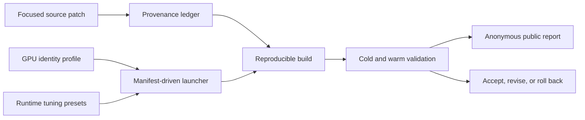

# AstraForge integration architecture

AstraForge treats integration as a first-class subsystem. Engine patches, GPU support, runtime presets, measurements, and credits use separate layers with explicit contracts. This lets a contributor add one focused capability without copying unrelated vendor assumptions.

## Layer contract

| Layer | Stable input | Required evidence | Can change without rebuilding? |
|---|---|---|---|
| Engine source | Atomic Git commit with upstream origin | Compile, focused tests, runtime correctness | No |
| GPU identity | Vendor/device IDs and required D3D12 features | Hardware probe and adapter-order validation | Yes |
| Runtime preset | Implemented and audited environment controls | Repeated matched gameplay captures | Yes |
| Build variant | Toolchain, flags, source commit | Manifest and executable SHA-256 | No |
| Benchmark route | Anonymous scene, cache state, resolution, duration | Application-frame classification and telemetry | Yes |
| Public report | Local comparison JSON | Allowlisted export with private paths removed | Yes |

## Fast contribution path

1. Describe one hardware target or one engine problem.
2. Import the smallest relevant patch and record its author, repository, commit or pull request.
3. Add or update a GPU manifest entry only when adapter and feature checks are known.
4. Keep tuning presets in data when the source already exposes a verified runtime control.
5. Build once per source/compiler variant; compare runtime profiles without unnecessary rebuilds.
6. Run matched cold and warm cohorts, review rendering, and publish only the sanitized report.

## Acceptance rules

A contribution is integrated only when its source and license are known, its scope is reversible, and the available checks match the risk of the change. Performance labels require repeated real application frames. Correctness changes require visual or focused runtime validation when compilation alone cannot prove them. Unsupported vendors remain absent from the manifest until their adapter path and validation exist.

## Standardization goal

The current schema starts with NVIDIA Ampere and one 8 GB profile. Future NVIDIA and AMD profiles should reuse the same identity, tuning, build, benchmark, attribution, and rollback contracts. Schema revisions must remain documented and machine-readable so external tools can consume profiles and reports without learning card-specific scripts.
